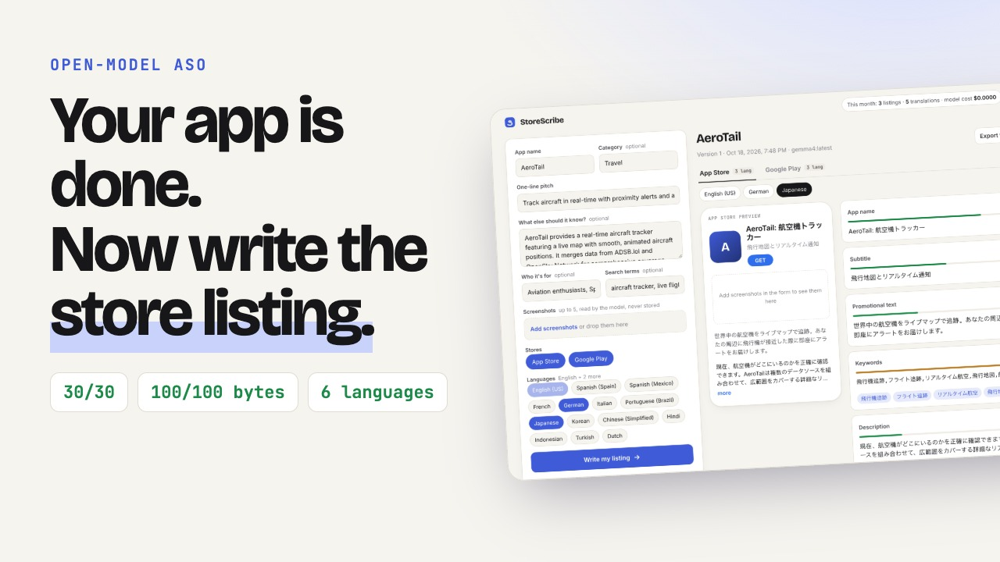
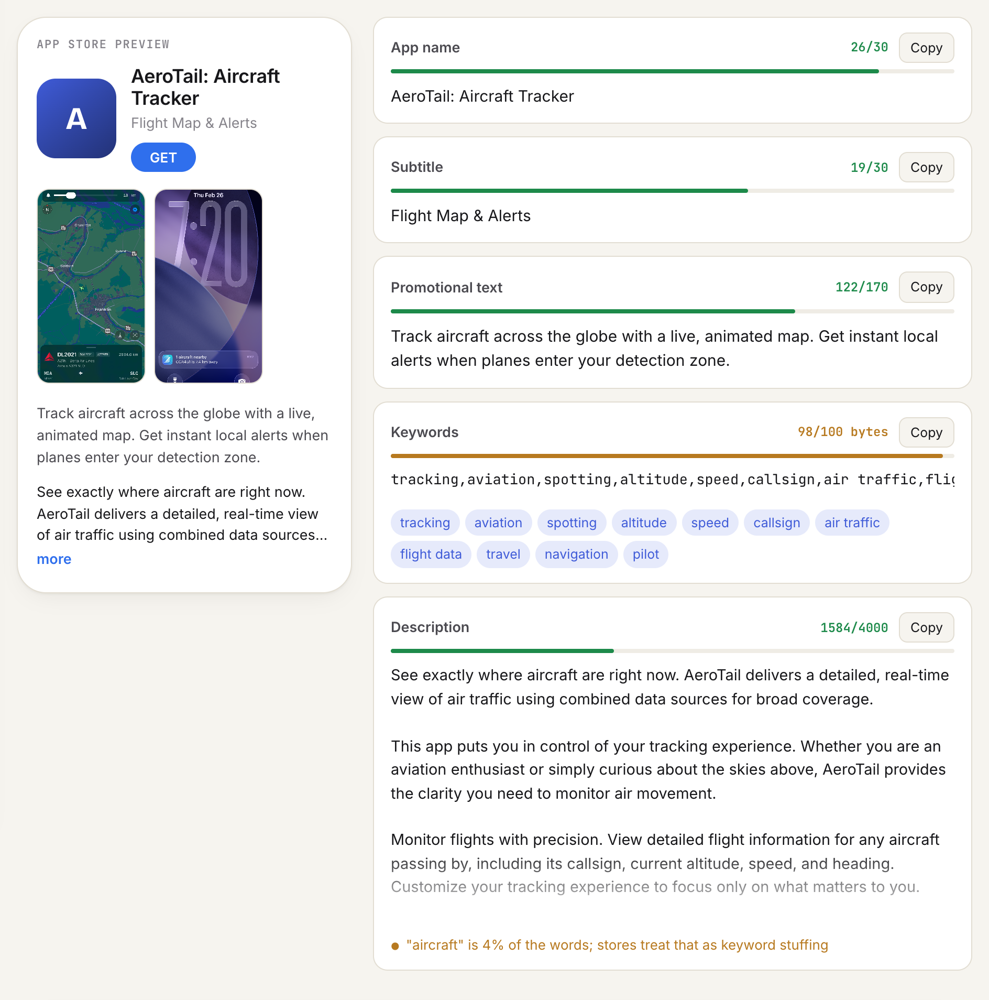
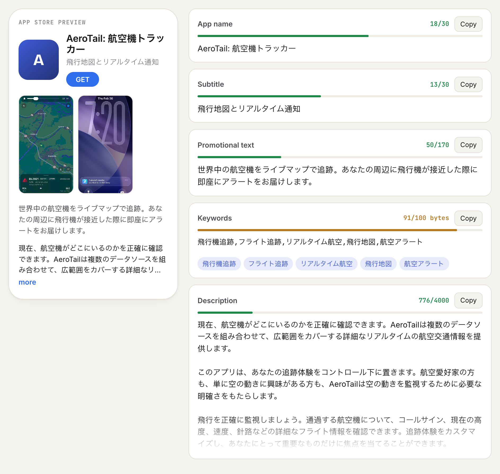
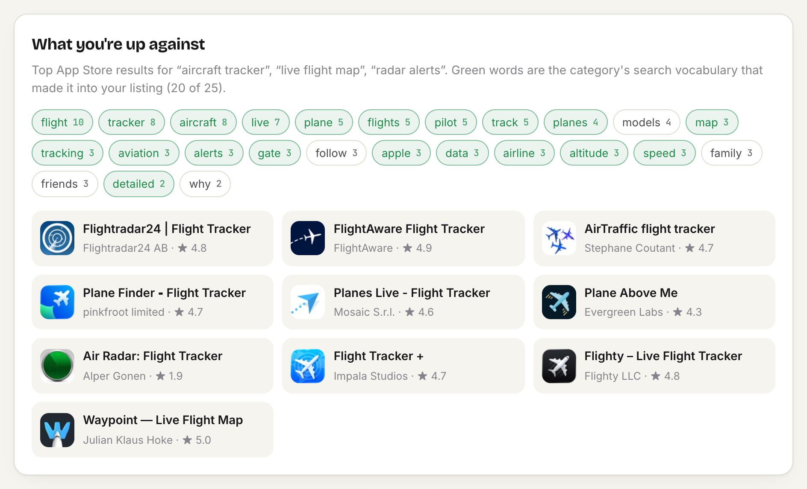
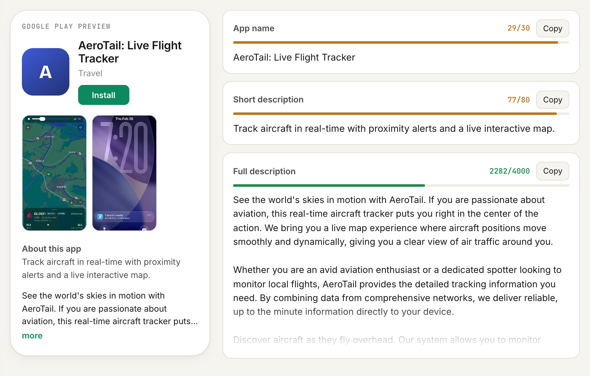
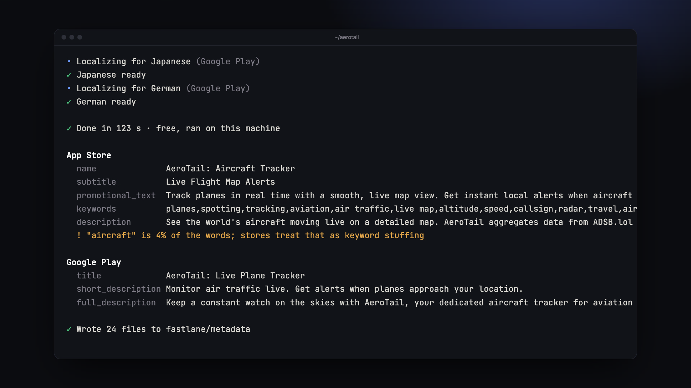
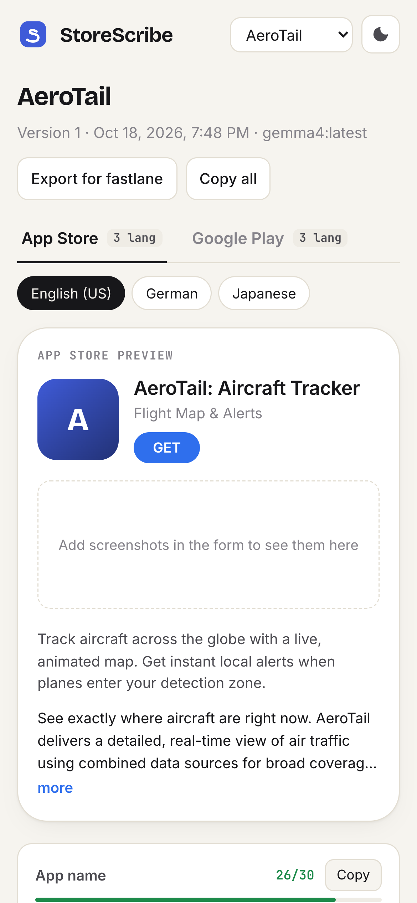
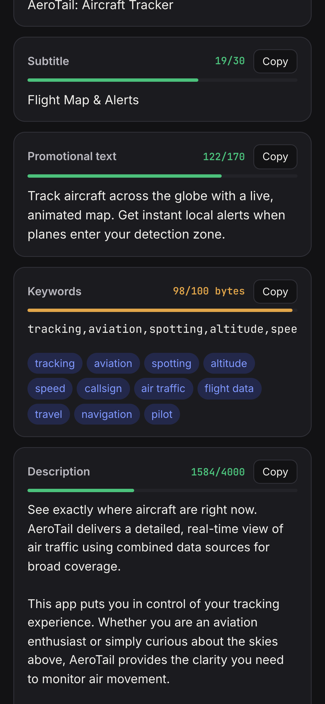

<p align="center">
  
</p>

<h1 align="center">StoreScribe</h1>

<p align="center">
  <b>App Store and Google Play listings that fit every limit, use the words your category searches with, and read like a person wrote them.</b><br>
  In English and up to five more languages. Written by <b>Gemma 4</b>, an open-weight model.
</p>

<p align="center">
  <a href="https://storescribe.souvikbiswas.com"><b>Try it: storescribe.souvikbiswas.com</b></a> ·
  <a href="https://youtu.be/tMNuL2SRbiA">Demo video</a> ·
  <a href="#cli">CLI</a>
</p>

<p align="center">
  <a href="https://youtu.be/tMNuL2SRbiA"></a>
</p>

## Why

Your app is done. Now the App Store wants a 30-character name, a 30-character subtitle, a keywords field of exactly 100 **bytes**, promotional text and a description, and Google Play wants its own set. Then the same again in every language you sell in. Japanese gets about a third of the keyword room, because Apple counts bytes, not characters.

StoreScribe studies the apps you're up against, then writes both listings inside every limit, in about two minutes.

## Screenshots

**Your listing, inside every limit.** A live App Store preview with your screenshots, and a counter on every field.



**Each language gets its own keywords.** Apple counts the keywords field in bytes, so Japanese gets about a third of the room; this one uses 91 of 100.



**What you're up against.** The top apps for your search terms, and which of the category's words made it into your listing.



**Google Play** gets its own title, short description and full description.



**Or run it in your repo.** The CLI reads the project and writes `fastlane/metadata`.



**On your phone**, in light and dark.

<p>
  
  &nbsp;
  
</p>

## What it does

- **Reads your screenshots** with Gemma's vision to see what the app actually does.
- **Researches the category:** the top App Store and Google Play results for your search terms (via SerpApi), and the words they all use.
- **Writes each field for each store**, then **code enforces the rules**: every limit (Apple's keyword field in bytes), banned title words on Google Play, keyword stuffing, repeated words in short fields. Anything that doesn't fit goes back to the model to be tightened, and is cut cleanly as a last resort.
- **Packs the keywords field**: most valuable terms first, no words already in the name or subtitle, no competitor brand names, no spaces after commas.
- **Localizes for each market**, with keywords people there actually type, not translated English ones.
- **Live editing** with counters and store-rule checks as you type, **every version kept**, **fastlane export**, and a **daily rank tracker** once you're live.

## CLI

Run it inside your app's repo. It reads the project (app name, bundle ids, README, the screens in your code, your current fastlane listing and any screenshots) and writes `fastlane/metadata` for you. Works with Flutter, React Native, Expo, Swift and Kotlin projects.

```sh
cd path/to/your-app
npx github:sbis04/storescribe --langs ja-JP,de-DE     # uses the hosted StoreScribe, with competitor research
npx github:sbis04/storescribe --local                 # Gemma on your machine with Ollama; nothing leaves your laptop
```

Options: `--stores ios,android`, `--terms "a, b"`, `--pitch "..."`, `--out DIR`, `--dry-run`, `-y`.

## Why an open model

- **Cost:** a full listing in six languages for both stores is about 13k tokens in and 10k out. At DigitalOcean's Gemma 4 price ($0.18 / $0.50 per million tokens) that's under a cent, which is what makes a $6/month plan work.
- **Privacy:** screenshots are read and thrown away. With `--local`, your unreleased app never leaves your machine.
- **No lock-in:** the model is one setting. Swap in a bigger open model, or fine-tune one on your best-converting listings.

## How it's built

| | |
|---|---|
| **Model** | Gemma 4 31B on DigitalOcean serverless inference (`gemma4` via Ollama locally) |
| **Hosting** | One DigitalOcean Droplet: Caddy (HTTPS) + the Node app |
| **Data** | Tiger Data (TimescaleDB): `listing_versions`, `keyword_ranks` and `usage` hypertables, and a `usage_daily` continuous aggregate for the usage meter |
| **Research** | SerpApi's App Store and Google Play engines, cached for a day |
| **Front end** | Plain HTML, CSS and JS; light and dark; desktop, tablet and phone |

## Run it yourself

```sh
npm install
cp .env.example .env   # DATABASE_URL, model settings, optional SERPAPI_KEY
npm run dev            # http://localhost:8090
```

| | `MODEL_API` | `MODEL_URL` | `MODEL_NAME` |
|---|---|---|---|
| Local (Ollama) | `ollama` | `http://localhost:11434` | `gemma4:latest` |
| DigitalOcean serverless inference | `openai` | `https://inference.do-ai.run/v1` | `gemma-4-31B-it` (+ `MODEL_KEY`) |

Deploy: `./deploy/up.sh` creates a DigitalOcean Droplet and deploys; `./deploy/down.sh` destroys it.

## Credits

- Demo voice: ElevenLabs ("Eric"). Music: "Autumn Acoustic Guitar" by YuraSoop (Pixabay).
- Example app in the demo: AeroTail, my plane-spotting app.

## License

MIT
